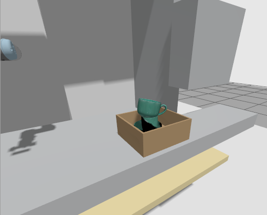

# picking_example

Pick and place in the Sharework cell, in Gazebo: objects on the table are
detected (YOLO), stored in the scene database (`scene_db`), grasped with VGN
grasps computed from close views of the wrist camera, and placed in a basket.
Motions are planned with `parallel_multigoal_planner`.



Step-by-step guide with images: [docs/TUTORIAL.md](docs/TUTORIAL.md).
Nodes, parameters, interfaces, conventions: [docs/API.md](docs/API.md).

```
 Gazebo (sim.launch.py)                         services.launch.py
 ├ cell + wrist RealSense ── /wrist/... ──────▶ scene_updater_wrist ─┬─ DetectObjects ─▶ yolo_rgbd_detector
 ├ objects, basket                               (acquire,            └─ MultiviewDetectGrasps ─▶ vgn_grasp_server
 ├ DetachableJoint per object                     capture_view,           (robostack env)
 └ sim_grasp_manager ◀── /joint_states            acquire_grasps) ──▶ scene_db
                                                 ur_ik_solver ◀─ parallel_multigoal_planner ─▶ collision_checker_server
                                                 compute_joint_trajectory (TOTG)                  (move_group scene)
 pick_and_place ── services / actions above ──▶ joint_trajectory_controller, robotiq_gripper_controller
```

## What happens

`pick_and_place` repeats, until no object is left (or `max_cycles`):

1. **Observe**: the wrist camera looks at the table obliquely from the robot
   side (`observation_points`: camera point and looked-at point); at each point
   `scene_updater_wrist/acquire` runs YOLO and updates `scene_db` (optionally
   also a fixed camera, `fixed_updater`). Images must be upright: YOLO (COCO)
   does not recognize cups seen from above or upside down.
2. **Planning scene**: the `scene_db` boxes (extended down to the table) and the
   basket go into the MoveIt scene, used by `collision_checker_server`.
3. **Choose** the free object in `pick_region` closest to the TCP. YOLO may
   report one object twice (a mug as `cup` and as `bowl`): the objects whose
   center is inside its footprint are treated as the same one (excluded from the
   MoveIt scene while grasping, removed from `scene_db` together).
4. **Grasps**: close views around the object (`grasp_views_deg`,
   `capture_view` each), then `acquire_grasps` (VGN multi-view on a volume
   around the object).
5. **Pick**: the best `max_grasp_candidates` grasps (approach at most 60° from
   the vertical, each also turned by 180°) are sent as alternative goals: the
   planner reaches the cheapest pre-grasp. Then approach along the gripper axis,
   close, attach the box to the robot in MoveIt, lift.
6. **Place**: the object is brought above the basket upright (8 yaws as
   alternatives), released, the robot retreats; the object is removed from
   `scene_db`.

A failed object is retried on the next cycle, at most `max_attempts_per_object`
times.

### Grasp in Gazebo

Contacts alone do not hold an object reliably in Gazebo. The robot description
(`urdf/sharework_picking.urdf.xacro`) has a `DetachableJoint` from the wrist to
each object of `config/objects.yaml`. `sim_grasp_manager` detaches them all at
startup (Gazebo attaches them when it loads), attaches the object between the
fingers when the gripper starts closing (ground-truth pose from Gazebo, near
`open_tip`) and detaches it when the gripper opens. `pick_and_place` only uses
the gripper action, as on the real cell.

### Wrist camera

A RealSense on `ur10e_tool0` with the calibration of the real cell (frames
`wrist_link`, `wrist_color_optical_frame`; topics `/wrist/color/image_raw`,
`/wrist/aligned_depth_to_color/image_raw`, `/wrist/color/camera_info`). It is
inclined by 45° and looks at the fingertips; observation and grasp views are
given as camera poses and converted to `ur10e_tool0` poses with TF.

## Requirements

Packages of `~/projects/ros2_ws`: `sharework_cell` (with `sharework_gazebo`),
`scene_db`, `scene_msgs`, `yolo_rgbd_detector`, `object_detection_msgs`,
`ik_solver`, `ur_ik_solver`, `ik_solver_msgs`, `collision_check_server`,
`parallel_multigoal_planner(_msgs)`, `mirrt_star`, `graph_core`,
`time_parametrization(_msgs)`, `grasp_detection_msgs`; `vgn_grasp_server` in
`~/projects/ros2_robostack_ws`. Environment variables of `ik_solver`:
`CNR_PARAM_ROOT_DIRECTORY`, `IK_SOLVER_LOGGER_CONFIG_PATH`.

The first start downloads the object models from Gazebo Fuel (internet
needed, cached in `~/.gz/fuel`) and the YOLO weights.

```bash
cd ~/projects/ros2_ws
colcon build --symlink-install --packages-up-to picking_example
source install/setup.bash
```

## Running

Four terminals, same `ROS_DOMAIN_ID` (do not run another cell bringup on the
same domain: its controller manager and `move_group` would clash). Start them
in this order; after restarting the simulation restart 2 and 3 too
(`collision_checker_server` exits when `move_group` goes away, and the nodes keep
TF from the old simulated time).

```bash
# 1. Gazebo, MoveIt, RViz, wrist camera bridge, sim_grasp_manager (gui:=false rviz:=false: headless)
ros2 launch picking_example sim.launch.py

# 2. Detector, scene_db, updaters, IK, collision checker, planner, time parametrization
source ~/venvs/yolo/bin/activate
ros2 launch picking_example services.launch.py          # fixed_camera:=zed to add a fixed updater

# 3. VGN (RoboStack environment)
conda activate ros2_robostack
cd ~/projects/ros2_robostack_ws && source install/setup.bash
ros2 launch vgn_grasp_server vgn_grasp_server.launch.py \
    params_file:=$HOME/projects/ros2_ws/install/picking_example/share/picking_example/config/vgn.yaml

# 4. The task
ros2 launch picking_example pick_and_place.launch.py
```

When a Cartesian goal has no valid IK solution, `pick_and_place` logs why
(out of reach, out of bounds, or the colliding link pairs).

Useful while it runs: `ros2 run scene_db cli list`. The RViz of
`sim.launch.py` (`rviz/picking.rviz`) shows the MoveIt scene, `/scene_db/markers`,
`/vgn_grasp_server/grasp_markers`, `/wrist/color/image_raw` and
`/yolo_rgbd_detector/debug_image`.

## Launch files

| File | Arguments |
|---|---|
| `sim.launch.py` | `gui`, `rviz`, `rviz_config`, `sim_cameras`, `world`, `description_file` |
| `services.launch.py` | `description_file`, `detector` (`true`), `fixed_camera` (`''`, or `zed`, `rs1`, `rs2`), `database_file` |
| `pick_and_place.launch.py` | `params_file` |

`sim.launch.py` uses the `description_file` argument of
`sharework_gazebo.launch.py`.

## Configuration

| File | Content |
|---|---|
| `config/pick_and_place.yaml` | Task parameters: frames, observation points, grasp views, pick region, basket, speeds |
| `config/objects.yaml` | Graspable objects (model and link names): one DetachableJoint each |
| `config/scene.yaml` | `scene_db`, `scene_updater_wrist`, `scene_updater_fixed` (classes `cup`, `bowl`) |
| `config/detector.yaml` | `yolo_rgbd_detector` for rendered images (`yolo11s-seg`: the nano model misses the cups) |
| `config/vgn.yaml` | `vgn_grasp_server` |
| `config/ik_solver.yaml` | `ur_ik_solver`: `ur10e_base_link` → `ur10e_tool0`, ±15° about the tool axis |
| `config/mirrt_star.yaml`, `collision_checker.yaml`, `time_parametrization.yaml` | Planner chain |
| `config/gz_bridge_wrist.yaml` | Wrist camera bridge |

Adding an object: an `<include>` in `worlds/picking.sdf` and a line in
`config/objects.yaml` (YOLO with COCO weights only knows COCO classes; add the
class to `classes` in `config/scene.yaml`). Moving the basket: world and
`basket_*` parameters together.

## Tests

```bash
colcon test --packages-select picking_example --event-handlers console_direct+
```

Unit tests of the pose math (`picking_example/geometry.py`). The whole chain was
tried headless (`sim.launch.py gui:=false`): the three objects end in the basket
in about 10 minutes on CPU.

## Limitations

- The Fuel models have no inertia (Gazebo uses 1 kg, unit inertia) and mesh
  collisions.
- Mugs and bowls are wider than the gripper: VGN grasps them on the rim.
- Without a GPU the cameras render at about 5 Hz and YOLO/VGN run on CPU: one
  object takes about 1-2 minutes.
- The white mug renders dark in Gazebo (model material); YOLO still finds it.
- MoveIt boxes of the objects come from the detected boxes (visible surface),
  extended to the table.
