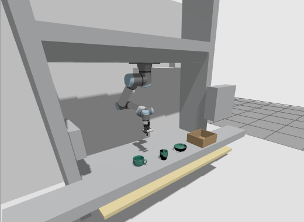
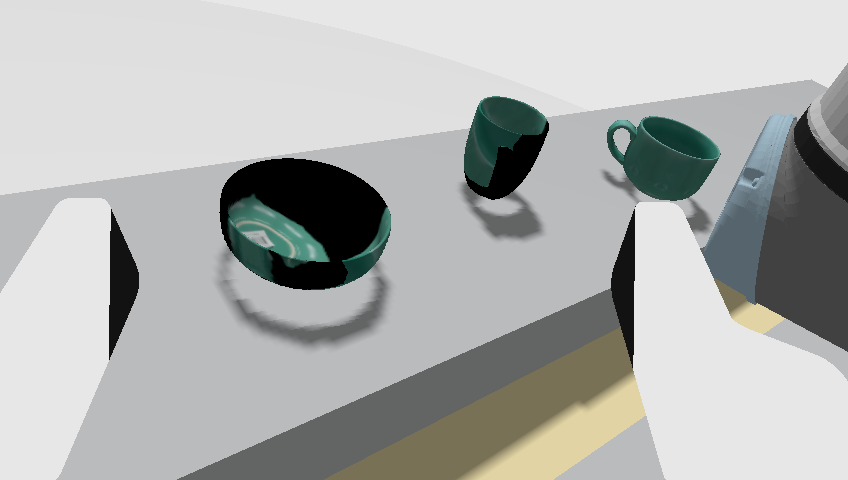
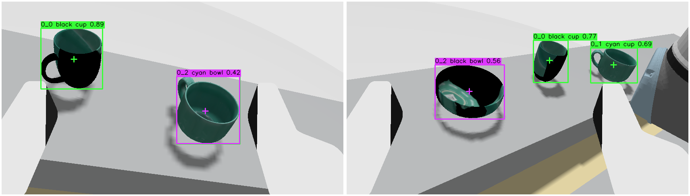
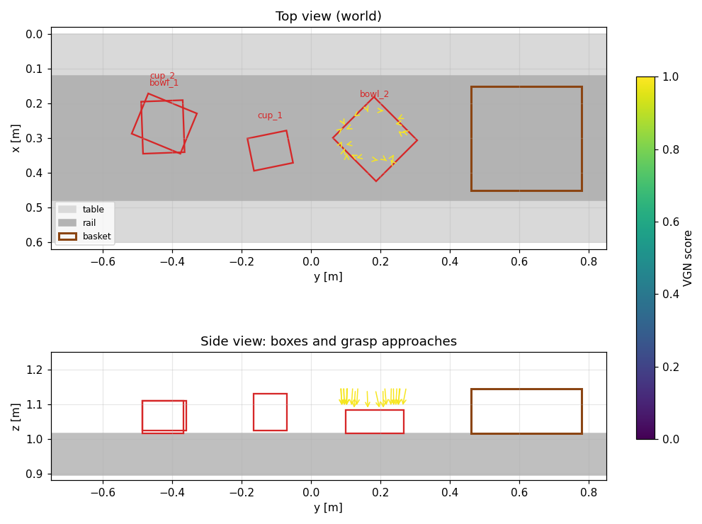
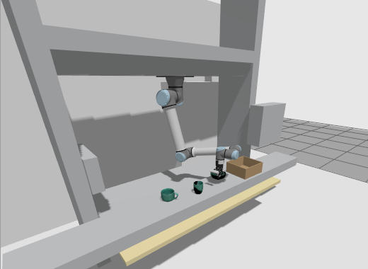
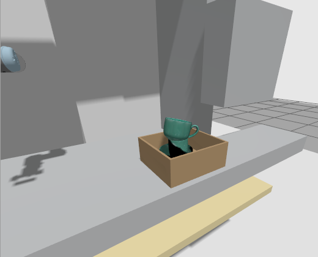

# picking_example: tutorial

From an empty table to three objects in the basket, in Gazebo. Then how to
change the scene: objects, basket, views, a fixed camera.
Reference of nodes and parameters: [API.md](API.md).

The images come from a run of the example (Gazebo window and topics; the
scene plot is drawn from `scene_db/query_objects`).

---

## 1. Build

```bash
cd ~/projects/ros2_ws
colcon build --symlink-install --packages-up-to picking_example
source install/setup.bash
```

VGN lives in the RoboStack workspace (`~/projects/ros2_robostack_ws`), already
built. The first start needs internet: the object models come from Gazebo
Fuel (cached in `~/.gz/fuel`) and the YOLO weights are downloaded once.

Use the same `ROS_DOMAIN_ID` in all the terminals, and no other cell bringup
on that domain (two controller managers and two `move_group` would clash).
To run beside another bringup, pick a free domain and Gazebo partition in each
terminal:

```bash
export ROS_DOMAIN_ID=77 GZ_PARTITION=picking
```

## 2. Simulation

```bash
ros2 launch picking_example sim.launch.py          # gui:=false rviz:=false for headless
```

Wait for:

```
[sim_grasp_manager]: All the objects are free
```

The cell, the two mugs and the bowl on the rail, the basket at the end of the
table:



RViz (`rviz/picking.rviz`) shows the MoveIt scene, the `scene_db` boxes, the
VGN grasps and two image panels (wrist camera, YOLO detections). They are empty
until the services run.

## 3. Services

```bash
source ~/venvs/yolo/bin/activate                  # ultralytics
ros2 launch picking_example services.launch.py
```

It starts YOLO, `scene_db` and the wrist updater, then the planner chain (IK,
collision checker, multi-goal planner, TOTG) once the planner parameters are
loaded. Ready when the log shows `yolo_rgbd_detector]: Ready` and
`action server ready`.

## 4. VGN

```bash
conda activate ros2_robostack
cd ~/projects/ros2_robostack_ws && source install/setup.bash
ros2 launch vgn_grasp_server vgn_grasp_server.launch.py \
    params_file:=$HOME/projects/ros2_ws/install/picking_example/share/picking_example/config/vgn.yaml
```

## 5. The task

```bash
ros2 launch picking_example pick_and_place.launch.py
```

On CPU each object takes 1-2 minutes. What happens:

### Observe

The robot points the wrist camera at the table from two oblique points. At
each one `scene_updater_wrist/acquire` runs YOLO and writes the objects in
`scene_db`.



The fingers are in the image: the camera is mounted to see the fingertips.
YOLO (COCO) recognizes the mugs as `cup`, but sometimes a mug also as `bowl`
(left image below: the right mug). The node treats two boxes with one center
inside the other's footprint as one object.



```
Observation 1: 3 detections, added ['cup_1', 'cup_2', 'bowl_1'], moved []
Observation 2: 3 detections, added ['bowl_2'], moved []
```

Check the database at any time:

```bash
ros2 run scene_db cli list
```

### Grasps

For the chosen object (the free one closest to the gripper) the camera takes
three close views (`capture_view`), then `acquire_grasps` runs VGN on the
volume around the object and stores the grasps in `scene_db`.

```
bowl_2: 21 grasps detected in 3 views, 20 assigned to the object
```

The scene at that moment: `scene_db` boxes (red; `cup_2` and `bowl_1` are the
same mug), basket, and the VGN grasps of `bowl_2` on its rim (arrows = approach
direction, color = score).



### Pick

The best grasps pointing downwards (each also turned by 180°) become
alternative goals of `parallel_multigoal_planner`, which plans to the cheapest
one. Then the gripper approaches along its axis, closes and lifts.
`sim_grasp_manager` attaches the object when the gripper closes on it:

```
[sim_grasp_manager]: Holding bowl
```



### Place

Above the basket, object upright, 8 yaws as alternatives; the gripper opens
(`Released bowl`), the robot retreats and the object is removed from
`scene_db`. Then the next cycle starts from the observation.

```
Picking bowl_2 (bowl, black) at (0.303, 0.184, 1.049)
bowl_2 is in the basket
Picking cup_1 (cup, black) at (0.337, -0.119, 1.077)
cup_1 is in the basket
Picking bowl_1 (bowl, cyan) at (0.263, -0.418, 1.067)
bowl_1: same object as ['cup_2']
bowl_1 is in the basket
Done: placed ['bowl_2', 'cup_1', 'bowl_1'], failed []
```



To run it again, restart all the terminals: `collision_checker_server` exits
when `move_group` goes away, and the nodes keep TF of the old simulated time.

---

## 6. Changing the example

### Add an object

1. An `<include>` in `worlds/picking.sdf`, with a unique `<name>`, pose on the
   rail (z ≈ 1.02), not `<static>`.
2. A line in `config/objects.yaml` (model name and link, `link_0` for the
   GoogleResearch models): one more DetachableJoint in the robot description.
3. If its COCO class is new, add it to `classes` in `config/scene.yaml`.
4. Rebuild (`colcon build --packages-select picking_example`), restart.

Objects wider than 8.5 cm can only be grasped on a rim or a handle.

### Move the basket

Change its pose in `worlds/picking.sdf` and `basket_center` (and
`basket_size`) in `config/pick_and_place.yaml` together. Keep it reachable from
above with the object upright.

### Change the views

- `observation_points`: camera point and looked-at point, 6 values each. Keep
  the views oblique and the image upright (small `observation_rolls_deg`):
  YOLO misses cups seen from above or upside down. A point right under the
  robot base is out of reach: the log says `Planning observation point k
  failed ... point skipped`.
- `grasp_views_deg` / `grasp_view_distance`: close views of VGN, as (tilt,
  azimuth) pairs around the object.
- `pick_region`: objects outside it are ignored.

### Use a fixed camera too

```bash
ros2 launch picking_example services.launch.py fixed_camera:=zed     # or rs1, rs2
ros2 launch picking_example pick_and_place.launch.py   # with fixed_updater: /scene_updater_fixed
```

Set `fixed_updater` in `config/pick_and_place.yaml`. The fixed camera adds
detections at every observation; grasps still come from the wrist views.

### When a motion fails

Planning errors carry the planner code (e.g. `-31` = no valid IK for the goals).
For Cartesian goals the node explains the first goal:

```
  no IK solution at all: pose out of reach
```

or a count of the IK solutions by cause, for example (object boxes are named
after the `scene_db` id):

```
  IK solutions of the first goal: {'cup_2-ur10e_robotiq_85_left_finger_tip_link': 6}
```

Collisions with an object box usually mean a duplicate detection or a box
larger than the object (`object_box_margin`); out of reach means the point or
the view is too far from the robot.

### Run on another machine without a display

```bash
ros2 launch picking_example sim.launch.py gui:=false rviz:=false
```

Camera rendering still needs a GPU or software OpenGL.
